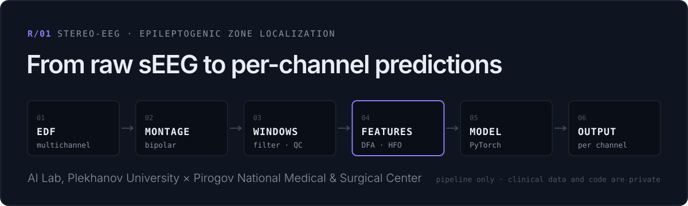
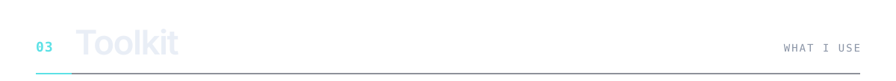
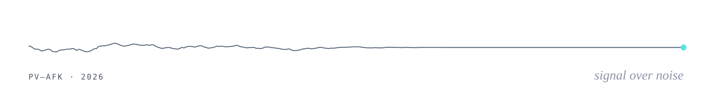

<picture>
  <source media="(prefers-color-scheme: dark)" srcset="assets/hero-dark.svg">
  <source media="(prefers-color-scheme: light)" srcset="assets/hero-light.svg">
  
</picture>

I build **credit-risk models** at Bank ZENIT and research **stereo-EEG signals** at the AI Lab of Plekhanov Russian University of Economics, together with clinicians from the Pirogov National Medical and Surgical Center. I care about leakage-free validation, calibrated probabilities and pipelines that re-run end to end.

[Selected work](#selected-work) · [Code](https://github.com/pv-afk/pv_afk) · [Telegram](https://t.me/pv_chirkin) · [Email](mailto:p.chirkin07@gmail.com)

 

<picture>
  <source media="(prefers-color-scheme: dark)" srcset="assets/section-01-dark.svg">
  <source media="(prefers-color-scheme: light)" srcset="assets/section-01-light.svg">
  
</picture>

**Credit risk · Bank ZENIT** — Risk Analyst / Developer, IFRS 9 & Modelling · *Apr 2026 – now* 
PD model development and recalibration · a reproducible pipeline for credit-history predictors · monitoring of internal and external scores, including on the reject sample.

**Computational neuroscience · AI Lab, Plekhanov University** — Research Assistant · *Mar 2026 – now* 
Machine learning for localizing the epileptogenic zone from stereo-EEG. Co-author of a paper at **Neuro AI 2026**.

<picture>
  <source media="(prefers-color-scheme: dark)" srcset="assets/research-dark.svg">
  <source media="(prefers-color-scheme: light)" srcset="assets/research-light.svg">
  
</picture>

  

<picture>
  <source media="(prefers-color-scheme: dark)" srcset="assets/section-02-dark.svg">
  <source media="(prefers-color-scheme: light)" srcset="assets/section-02-light.svg">
  
</picture>

Two joined credit-bureau tables → stratified split, imputation and one-hot encoding, class rebalancing, `RandomizedSearchCV` for Logistic Regression vs XGBoost. XGBoost reaches **macro-F1 0.71 / accuracy 0.80** on 10,268 held-out applicants (LogReg: 0.50 / 0.56). → [notebook](https://github.com/pv-afk/pv_afk/tree/main/projects/credit-scoring)

Avito DS Bootcamp. Only events before assignment time (`event_ts < assignment_ts`), recency and multi-window activity features (6 h – 60 d), a blend of two LightGBM variants, CatBoost and the base ensemble. **Daily AP 0.739 / 0.760** vs 0.714 / 0.740 baseline on two sequential local holdouts; the hidden test score is not known. → [code](https://github.com/pv-afk/pv_afk/tree/main/projects/lead-prioritization)

Parametric keys (dose, volume, pack size via regex) vs character n-gram Jaccard similarity, with the threshold tuned on precision / recall / F1. Best: **F1 0.69** (n = 5, threshold 0.50); the write-up argues for a hybrid of both. → [notebook](https://github.com/pv-afk/pv_afk/tree/main/projects/pharmacy-analysis)

Full statistical cycle: Box-Cox, seasonal differencing, `auto_arima` search, SARIMAX(6,1,2)(0,1,0)[12], inverse transform and a 36-month forecast. → [notebook](https://github.com/pv-afk/pv_afk/tree/main/projects/average-salary)

Also in the repo: [IT budget forecasting](https://github.com/pv-afk/pv_afk/tree/main/projects/cost-prediction) · [IT portfolio optimisation](https://github.com/pv-afk/pv_afk/tree/main/projects/it-portfolio) · [digital maturity analysis](https://github.com/pv-afk/pv_afk/tree/main/projects/it-strategy) · [ML foundations notebooks](https://github.com/pv-afk/pv_afk/tree/main/ML-AI). In progress: a local RAG copilot for credit analysts (hybrid FAISS + BM25 retrieval, cited answers) — code will be published when it is ready.

  

<picture>
  <source media="(prefers-color-scheme: dark)" srcset="assets/section-03-dark.svg">
  <source media="(prefers-color-scheme: light)" srcset="assets/section-03-light.svg">
  
</picture>

**Modeling** — scikit-learn · XGBoost · CatBoost · LightGBM · imbalanced-learn · statsmodels · pmdarima 
**Signals** — MNE · pyEDFlib · SciPy · PyTorch (inference) 
**Data** — Python · SQL (PostgreSQL, MySQL, SQLite) · pandas · NumPy · Matplotlib 
**Familiar with** — Docker · MLflow · Airflow · PySpark · FastAPI · Streamlit · FAISS · Sentence Transformers

 

<picture>
  <source media="(prefers-color-scheme: dark)" srcset="assets/section-04-dark.svg">
  <source media="(prefers-color-scheme: light)" srcset="assets/section-04-light.svg">
  
</picture>

**BSc, Artificial Intelligence Systems & Technologies** — Plekhanov Russian University of Economics, 2024 – 2028 
Finalist, Plekhanov Case Club × Alfa-Bank case championship, 2026 · REA Data Science club, 2025 – 2026

**Contact** — [Telegram @pv_chirkin](https://t.me/pv_chirkin) · [p.chirkin07@gmail.com](mailto:p.chirkin07@gmail.com)

<picture>
  <source media="(prefers-color-scheme: dark)" srcset="assets/footer-dark.svg">
  <source media="(prefers-color-scheme: light)" srcset="assets/footer-light.svg">
  
</picture>
