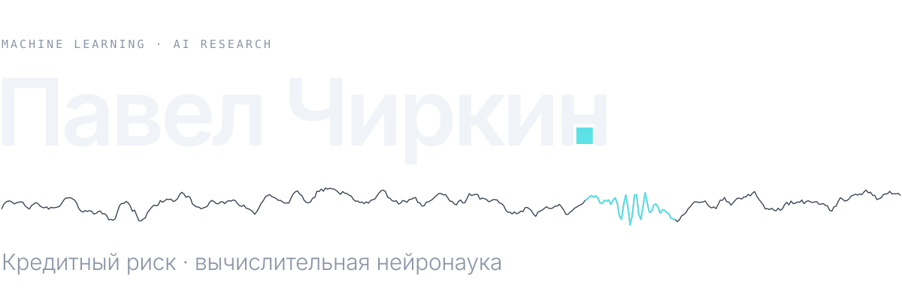
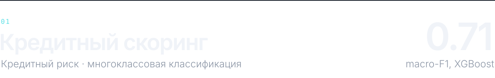

<picture>
  <source media="(prefers-color-scheme: dark)" srcset="assets/hero-dark-0152ab0a.svg">
  <source media="(prefers-color-scheme: light)" srcset="assets/hero-light-906b504c.svg">
  
</picture>

Разрабатываю модели кредитного риска в Банке ЗЕНИТ и занимаюсь AI Research в лаборатории искусственного интеллекта РЭУ им. Г. В. Плеханова: вместе с НМХЦ им. Н. И. Пирогова применяем машинное обучение к сигналам стерео-ЭЭГ. Мне важны честная валидация без утечек, откалиброванные вероятности и воспроизводимые пайплайны.

 

### Специализация

**Моделирование кредитного риска** · Банк ЗЕНИТ, аналитик-разработчик · с апреля 2026 
Разработка, калибровка и мониторинг PD-моделей, воспроизводимый расчёт предикторов по кредитной истории, анализ внутренних и внешних скорингов, в том числе на отказной выборке.

**Вычислительная нейронаука** · Лаборатория ИИ РЭУ, лаборант-исследователь · с марта 2026 
Локализация эпилептогенной зоны по стерео-ЭЭГ: обработка EDF, биполярный монтаж, признаки DFA и HFO, интеграция PyTorch-модели. Соавтор работы на конференции Neuro AI 2026.

 

### Избранные проекты

<picture>
  <source media="(prefers-color-scheme: dark)" srcset="assets/card-credit-scoring-dark-908fa71e.svg">
  <source media="(prefers-color-scheme: light)" srcset="assets/card-credit-scoring-light-11e0a4b9.svg">
  
</picture>

Прогноз исхода кредитной заявки (4 класса) для 51 336 клиентов: объединение двух таблиц, балансировка классов, подбор гиперпараметров. На отложенной выборке XGBoost даёт macro-F1 0.71 и accuracy 0.80 против 0.50 и 0.56 у логистической регрессии. [Код →](https://github.com/pv-afk/pv_afk/tree/main/projects/credit-scoring)

<picture>
  <source media="(prefers-color-scheme: dark)" srcset="assets/card-lead-prioritization-dark-28115ce4.svg">
  <source media="(prefers-color-scheme: light)" srcset="assets/card-lead-prioritization-light-d2313413.svg">
  
</picture>

Ранжирование обращений по вероятности целевого действия в течение пяти дней. Признаки строятся только по событиям до момента назначения; финальный ансамбль — LightGBM и CatBoost. Прирост +0.020 к базовой модели на отложенной по времени выборке; результат на скрытом тесте неизвестен. [Код →](https://github.com/pv-afk/pv_afk/tree/main/projects/lead-prioritization)

<picture>
  <source media="(prefers-color-scheme: dark)" srcset="assets/card-product-matching-dark-d33125ca.svg">
  <source media="(prefers-color-scheme: light)" srcset="assets/card-product-matching-light-01ad1b0a.svg">
  
</picture>

Поиск одинаковых препаратов в трёх прайс-листах с разной записью названий: параметрический ключ (дозировка, объём, фасовка) против сходства Жаккара по символьным N-граммам с подбором порога. [Код →](https://github.com/pv-afk/pv_afk/tree/main/projects/pharmacy-analysis)

Остальные работы — прогнозирование временных рядов, оптимизация ИТ-портфеля, базовые ML-ноутбуки — в репозитории [pv_afk](https://github.com/pv-afk/pv_afk).

 

### Контакты

[Telegram](https://t.me/pv_chirkin) · [p.chirkin07@gmail.com](mailto:p.chirkin07@gmail.com)

Бакалавриат «Системы и технологии искусственного интеллекта», РЭУ им. Г. В. Плеханова, 2024–2028
